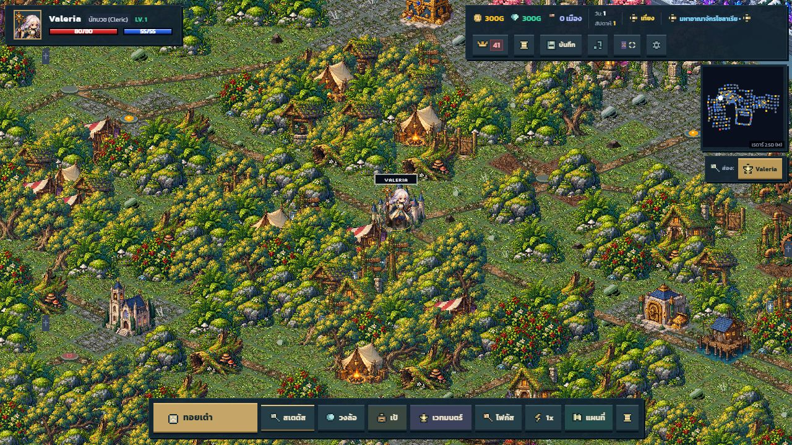

# ⚔️ Chronicles of Fortune (บันทึกแห่งโชคชะตา)

A 2.5D Isometric RPG Board Game inspired by **Dokapon Kingdom** featuring original fantasy pixel art, tactical combat dioramas, and competitive party mechanics.

Single-player board campaign against up to 3 AI rivals, local hot-seat play, and online P2P rooms for 2–4 players with optional AI slots.

The October 22 update adds a destination planner with service/treasure/risk filters,
combat estimates and explicit travel confirmation; a campaign journal with goals,
standings and nearby services; stable, cached HUD rendering; validated save imports
and recovery copies; and complete map sprites with illustrated loading and jade/brass
UI artwork. Open **สมุดนักผจญภัย** in the system menu, press **?**, or choose the
title-screen guide. [Changes and verification](docs/adventure-upgrade-v1/README.md).

### Choosing where to walk

Every turn can start in either direction, including back along the road you used last
turn. Roll the dice, then click/tap a highlighted destination or use the new destination
dock: **ก่อนหน้า / ถัดไป** previews each option and **เดินไปที่นี่** confirms it.
The preview shows the actual step count, region, encounter chance and rival presence.
Use **arrow keys / WASD** to browse, **Enter** to walk, and **F** to return the camera
to your hero. Controller D-pad and confirm use the same destination selection.

Normal movement still uses the exact dice total; a flexible movement crystal allows
shorter stops. During a route, U-turns are allowed at dead ends. Roads, step totals and
turn state are validated before travel so stale clicks cannot skip tiles or start two moves.
Destination controls are private to the active human and pause while a dialog is open.

### Online multiplayer

Choose **ผจญภัยกับเพื่อน**, create a room, and share its `CF-1234` code or invitation link.
The host chooses the party size and mode. Every slot must contain a connected player or
an enabled AI before starting. Room settings and character changes synchronize immediately.

The active human's device resolves that turn's movement, encounters and choices; the host
resolves AI turns. Other devices receive the board position and the completed turn state,
including inventory, world changes and the next player. PvP participants receive their own
attack/defence choices; one device resolves combat so random results cannot diverge.

Use **กลับเข้าห้อง** after refreshing. Seats are reserved by the tab's session identity.
A refreshed active player resumes a shared board checkpoint, rather than restoring a
partially completed combat or event dialog. The host must return to the same room after
refreshing; host migration is not supported. Internet play uses PeerJS/WebRTC signaling
and public STUN servers, so restrictive networks that require a TURN relay may not connect.
Tabs on the same origin can also communicate through BroadcastChannel.

See [multiplayer verification](docs/MULTIPLAYER.md) for the protocol and regression coverage.



The game now has a unified brass-and-midnight fantasy interface: a new title menu,
world HUD, combat deck, satchel grid and responsive shop panels.
[Interface screenshots and validation](docs/art-review/interface-v4/README.md).

The latest polish fixes overlapping skill compositions, frame-edge mattes, transparent
event dialogs and unfinished-art flashes, and adds a brighter palette.
[Current screenshots and regression checks](docs/art-review/visual-fixes/README.md).

---

## 🌟 Key Features

### 1. 🎲 Dokapon Kingdom Inspired Gameplay
- **Board Movement**: Roll spinners/dice, navigate branching crossroad paths, and capture towns.
- **Simultaneous Combat Mindgames**:
  - **Attacker**: `Attack` (Basic Phys) | `Strike` (Pierces Def) | `Magic` (Elemental) | `Skill` (Class Specialty)
  - **Defender**: `Defend` (Halves Attack) | `Counter` (Punishes Strike) | `Magic Guard` (Blocks Spells) | `Give Up` (Surrender)
- **Town & Economics System**: Liberate monster-infested settlements, collect local taxes, and invest in infrastructure.
- **PvP Revenge & Humiliation**:
  - Rob loser's gold, steal weapons/armor, take town deeds, or scribble hilarious graffiti on their face with the interactive canvas.
- **The Darkling Pact**:
  - Lagging behind? Make a demonic pact with Overlord Rico! Sacrifice your belongings for temporary combat bonuses, two movement dice, and global calamities.
- **Royal Weekly Report**: Weekly net worth ceremonies hosted by the King.

### 2. 🎨 Fortuna pixel-art overhaul

The expanded living world spans about 15,000 × 6,600 native world pixels, with dense forests, regional ground materials, ruins, waterfalls and settlement dressing. [World art details and validation](docs/art-review/LIVING_WORLD.md).
- Original versioned art in `public/assets/art-v2/`: six hero bases, eight directions,
  motion and action sheets; eighteen monster families, combat poses; twenty-seven companions
  and three town hosts; sixteen building cells and twenty tree silhouettes.
- Hero promotion identity follows all eighteen tier-2/tier-3 jobs, with equipment accents,
  four appearance variants and Darkling regalia. Finished actor sprites retain native pixels.
- The floating kingdom uses 96×48 terrain projection, authored palettes for fifteen biomes,
  day/night tiles, clustered vegetation, transition edges, quiet roads and depth-sorted actors.
- Battles share the world's materials, sky, vegetation and landmarks. Seven elemental effect
  ramps use pixel particles. Ink/brass/jade UI includes pixel pictograms and responsive panels.
- Atlases load on demand; bounded frame caches, cached scenery, balanced atmosphere and reduced
  motion keep the artwork usable on smaller screens. Existing artwork remains as fallback.
- Open `http://localhost:5173/art-review.html` after `npm run dev` for the actual runtime
  art gallery: directions, poses, promotions, skins, monsters, terrain, structures, effects,
  settlements and PNG export. Inspect at 1×/2× or fit the gallery to the viewport.
- Production rules, coverage and remaining verification are recorded in [ART_DIRECTION.md](ART_DIRECTION.md).

### 3. 🗺️ The World
A rebuilt fantasy world of **760 spaces** across **6 realms and 15 regions**, including **45 towns**, dedicated service districts and **19 regional crossings**. Three separate dungeons add **108 spaces across 18 rooms**. See the [world rebuild and generated art collection](docs/art-review/world-rebuild-v1/README.md).

### 4. 💖 Companions
**27 recruitable companions**, each with its own **64×64 pixel-art model**, drawn from the
monster girls you spare in battle, the guild's hired mercenaries, and story events. A
companion can be summoned once per battle for a powerful assist, and the emergency assist
can save a hero from a killing blow. Every companion's model is generated from a single
data file, so adding one is a JSON entry plus `npm run gen:companions`.

The models follow one light source (top-left) applied through a light map, five-stage
hue-shifted ramps per material, and selective outlining, so the shading reads at a glance
instead of looking flat. Each character's silhouette is built from its own name — the
kitsune miko carries nine tails and a gohei wand, the gunner a top hat and a gatling gun,
the mummy queen a nemes headdress and wrapped bandages. The art recipe also supports
per-character effects: the Slime Princess wields an acid-gel rapier whose blade grades
emerald to sapphire, surrounded by four bursting high-pressure acid bubbles
(`bladeGradient` and `bubbleBurst` in her recipe). `npm test` verifies that every companion
has a shaded, uniquely-lit, non-duplicate model.

### 5. Living-world rules rebuild

The campaign now uses one serializable world state for regional weather, forecasts, time,
threat, event memory, dungeon expeditions and boss objectives. Time advances once per full
round, regardless of party size. The event director contains 73 definitions across all 15
biomes, including unique landmarks, weather/night encounters and delayed NPC follow-ups.

Enemies retain authored regional strength: better equipment and character growth make old
regions easier. Scouting and battle creation share the same roster, weather modifiers,
elemental weaknesses and encounter probability. Magic consumes MP and class skills are
limited to one use per battle. Class growth and the experience curve support campaign progression.

Standard campaigns run for 42 days with optional 12,000G, eight-town or Abyss-guardian goals.
Co-op requires three named regional guardians within 30 days; Blitz runs 20 days; Roguelike
Draft offers a player choice every week for 28 days; Endless Spire continues with stronger
bosses. Dungeon floors track torchlight, opened chests and guardian completion. Rewards,
city income and catch-up mechanics have been rebalanced, with repeat-claim exploits closed.

**Rules version 2 starts a new campaign; older saves are not migrated.**
[Architecture, rules and verification](docs/RULES_REBUILD.md).

---

## 🚀 Getting Started

### Prerequisites
- **Node.js v22 or higher** (the test suite uses `node --test` glob patterns)
- npm

### Installation
```bash
git clone https://github.com/Lunasias/chronicles_of_fortune.git
cd chronicles_of_fortune
npm install
npm run dev
```

Open [http://localhost:5173](http://localhost:5173) in your browser to start your adventure!

### Building for Production
```bash
npm run build
npm run preview
```

---

## 🧪 Development

| Command | What it does |
| --- | --- |
| `npm run dev` | Vite dev server with HMR |
| `npm run typecheck` | Strict TypeScript check, no emit |
| `npm run build` | Type check + production bundle (incl. compiled Tailwind CSS) |
| `npm test` | Unit tests for board-data integrity, HTML escaping, save/load, enemy scaling, facing, and the 64×64 companion / structure / tree models |
| `npm run check:css` | Verifies every utility class used by the app is in the compiled stylesheet |
| `npm run gen:companions` | Regenerates the 64×64 companion models from `src/game/companions.json` |
| `npm run gen:buildings` | Regenerates the 13 structure models into `public/assets/buildings/` and the review sheet `.building-sheet.png` |
| `npm run gen:foliage` | Regenerates the 20 tree models into `public/assets/foliage/` and the review sheet `.foliage-sheet.png` |
| `npm run gen:terrain` | Regenerates the 60 floor tiles into `public/assets/terrain/` and the review sheet `.terrain-sheet.png` |
| `npm run gen:props` | Writes the floor-clutter review sheets (`.prop-sheet.png`, `.prop-variants-sheet.png`); props are runtime-only, so no per-model PNGs |
| `npm run gen:sky` | Regenerates the 4 skies, 4 suns and the moon into `public/assets/sky/`, plus the cloud and celestial review sheets |
| `npm run gen:art` | All of the above art generators |
| `npm run verify` | Everything CI runs: typecheck → build → test → CSS coverage |

**Always run `npm run verify` before pushing.** CI runs the same command.

### Reviewing art

The browser gallery at `/art-review.html` is the primary visual review surface.
It uses the same renderers as the game; PNG export preserves the canvas at native resolution.

For a terminal-only fallback, `scripts/lib/preview_companion.cjs` renders any folder of same-sized sprites as ASCII, which is
how the models are checked in a terminal:

```bash
node scripts/lib/preview_companion.cjs --dir=public/assets/buildings --full
node scripts/lib/preview_companion.cjs --dir=public/assets/terrain --full
```

The `--dir` mode is generic — it reads whatever PNGs it finds, so it works for structures, trees
and floor tiles as well as companions. The `.building-sheet.png`, `.foliage-sheet.png`,
`.terrain-sheet.png`, `.prop-sheet.png`, `.sky-sheet.png` and `.cloud-sheet.png` files written by
the generators are the enlarged contact sheets for review; all of them are gitignored because they
are derived from the committed per-model PNGs.

### Project layout
```
src/
  engine/   Canvas renderers: isometric board, terrain, characters, VFX, audio
  game/     Rules and state: board data, combat, economy, events, save/load
  ui/       DOM and canvas UI layers
  util/     Small shared helpers (HTML escaping)
  styles/   Tailwind entry point
reference/  Artist source art for scripts/generate_all_sprites.cjs.
            Deliberately NOT under public/ so it is not shipped to production.
scripts/    Manual one-off dev tooling - see scripts/README.md
tests/      node:test suites (compiled from src by npm run pretest)
```

---

## 🛠️ Tech Stack
- **Framework**: Vite + Vanilla TypeScript (strict)
- **Rendering Engine**: HTML5 Canvas (Procedural Pseudo-3D Volumetric Pixel Art & 2.5D Isometric Diorama)
- **Audio**: Web Audio API Procedural Synthesizer (Retro 8-bit/16-bit sound effects & melodies)
- **Styling**: Tailwind CSS compiled at build time (no CDN) + custom Dokapon pixel UI classes
- **Tests**: `node:test` (no test-runner dependency)

### Notes for maintainers
- `src/game/BoardMap.ts` is both the level data **and** the pristine baseline for a new
  game. Runtime board state (town ownership, town levels, built homes) lives on a deep
  clone created by `GameState.resetBoard()`; never mutate the module constant directly.
- A hero's `nodeId` is authoritative for where it is, not `gridX/gridY/gridZ`. The grid
  coordinates are interpolated during a walk, and `executeSingleStep` commits `nodeId` to the
  destination at the start of the step, so the two disagree mid-animation. `SaveManager`
  re-derives the coordinates from the node in both directions for exactly this reason.
- Two nodes can share a tile and differ only in elevation (a cliff or bridge). Stepping
  between them has no on-screen bearing, so `calculateIsoDirection` takes the current facing
  as a fallback instead of inventing a direction.
- Board and sprite data are generated/edited by the scripts in `scripts/`. Two of them
  rewrite tracked source - they are dry-run by default and require `--write`.
- Hero names and prank nicknames are user input. Escape them with `escapeHtml()` from
  `src/util/Html.ts` (or use `textContent`) before putting them in `innerHTML`.
- `src/game/companions.json` is the single source of truth for companions: names, skill text
  and the art recipe for the 64×64 model. `CompanionDatabase.ts` reads it at runtime and
  `scripts/generate_companion_sprites.cjs` reads it to draw the PNGs, so a companion cannot
  exist without a model. `npm test` enforces that.
- Enemy stats in `BoardMap` and `MonsterDatabase` are authored regional strength. Build
  encounters through `getNodeEncounterPreview()` and apply `prepareCombatant()` once, so
  scouting, weather, elemental traits and the actual fight stay consistent. Never scale
  an enemy in response to the hero’s gear or health.
- `src/engine/IsometricBuildingPainter.ts` and `src/engine/IsometricFoliagePainter.ts` are pure
  buffer painters: they must not import anything that touches the DOM, because
  `scripts/generate_building_sprites.cjs` / `generate_foliage_sprites.cjs` compile and run them
  off-line. The matching `Isometric*Renderer.ts` classes are the only DOM-facing part, and they
  only convert a painted buffer into a cached canvas.
- Those two painters are the single source of truth for map art. `tests/buildings.test.mjs` and
  `tests/foliage.test.mjs` re-paint every model and compare it byte-for-byte against the
  committed PNG, so editing a painter without re-running `npm run gen:art` fails the suite
  rather than silently leaving stale images on disk.
- Sprite anchors are exact. A structure's footprint diamond is centred at sprite `(32, 48)` and a
  tree's root collar at `(32, 54)`, so they are blitted at `(px - 32, py - 48)` and
  `(px + 20, py - 48)`. Changing `BUILDING_BASE_Y` or `FOLIAGE_BASE_Y` moves every model on the
  board, and `npm test` asserts the base still lands inside the seating band.
- The event feed (`#gameEventFeedWindow`) must stay readable behind a modal. `ShopUI` and
  `TownUI` call `syncFeedPanelClass()` from `src/util/PanelFocus.ts` whenever they open or close,
  which toggles `body.panel-open`; the CSS in `index.html` then raises the feed above the modal
  on wide screens and docks it to the top edge on narrow ones. Add any new full-screen panel to
  `FEED_PANELS` there instead of hard-coding z-index classes in the markup.
- The whole UI is built from component classes in the inline `<style>` in `index.html`
  (`pixel-box`, `pixel-btn`, `pixel-bar`, `pixel-head`, `pixel-well`, `pixel-chip`, `pixel-close`,
  `pixel-tab`, `pixel-row`, `command-card`). They are defined there rather than in a Tailwind
  layer so `npm run check:css` can see them. Do not reintroduce `border-radius`,
  `backdrop-filter`, blurred `box-shadow` or eased `transition` in the chrome — `check:css` fails
  the build if a glass utility reaches the built markup, because one rounded blurred panel is
  enough to make the entire UI read as a modern glass card again.
- Colour variants are written as two-class selectors (`.pixel-btn.pixel-btn-gold`) on purpose.
  A bare class ties with a Tailwind utility on the same element and lets source order decide the
  winner.
- **Never round-trip a source file through a PowerShell `Get-Content | Set-Content` pipeline.**
  `index.html` and several UI sources contain Thai text, and that pipeline re-encodes the whole
  file and replaces every non-ASCII character — silently, with a build that still succeeds but a
  UI full of mojibake. Use the file tools, or a Node script, as
  `scripts/apply_pixel_ui_style.cjs` and `scripts/strip_glass_ui.cjs` do.

---

## 📜 License
MIT License - see [LICENSE](LICENSE).

### Battle effects

The [shop artwork and layout update](docs/art-review/shop-interiors-v1/README.md) adds four generated interiors, centered responsive shops and persistent purchase/service feedback above the dimming layer.

The [generated background collection](docs/art-review/backdrops-v1/README.md) supplies 18 distinct panoramas for all 15 biomes and three dungeon interiors. Open `/backdrops-review.html` to inspect the full collection.

The [combat flow and navigation update](docs/art-review/navigation-flow/README.md) adds continuous recovery, generated destination markers and clickable offscreen direction guidance around the hero.

The [generated combat artwork](docs/art-review/combat-v3/README.md) delivers 132 owner-specific and shared animations (792 frames) in 33 transparent PNG atlases. Every effect pixel comes from generated raster artwork. Open `/effects-review.html` to select a job, monster or companion and scrub its animation.

The [presentation update](docs/art-review/presentation-v1/README.md) adds 225 generated animation cells for all 18 promoted jobs, all 27 companions, six contact effects and six living-world details. Combat has class-specific preparation and recovery, boss introductions and visible MP/status hints. Equipment comparisons and inventory filters work on desktop and mobile. Open `/presentation-review.html` to inspect the new runtime artwork and animation phases.
