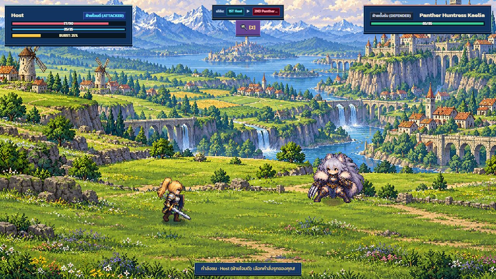
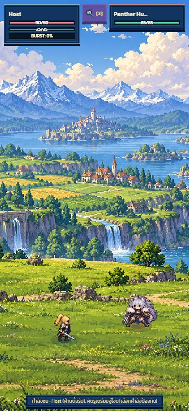
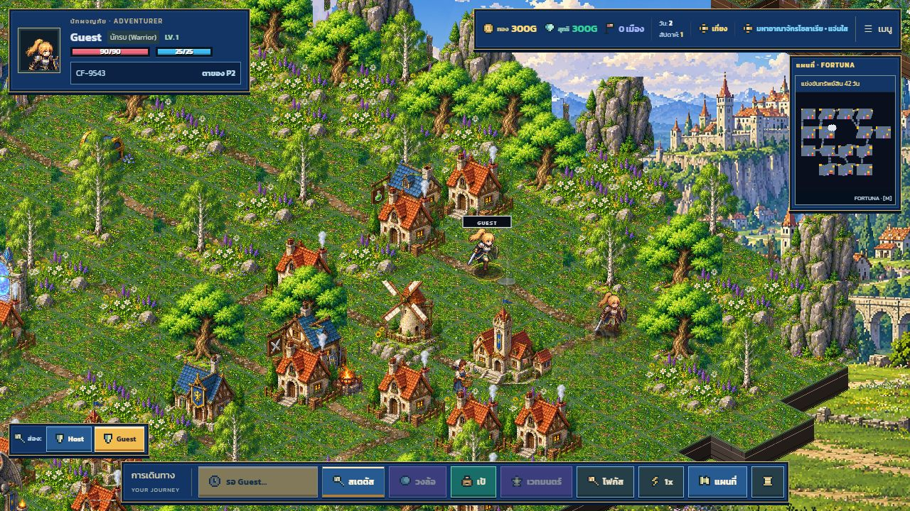
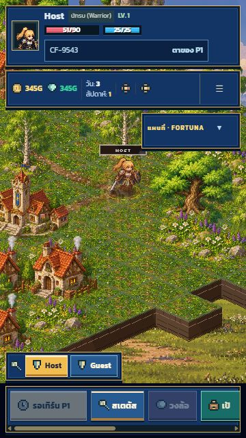

# Multiplayer repair and verification

The previous implementation replayed movement and encounters on every device, including
AI route selection and world random draws. Guest snapshots were ignored by the host,
and a guest could no longer send the final snapshot after changing the active player.

## Ownership and synchronization

- Only the active human simulates a human turn. Only the host simulates AI turns.
- Turn snapshots identify the **previous** owner when handing off to the next player.
  Both hosts and guests accept snapshots from that owner.
- Live snapshots preserve dice/movement phase and remaining moves. Disk-save recovery
  still returns to a board checkpoint.
- Spectators update board position without triggering movement damage, events, shops,
  battles, weekly drafts or additional random draws.
- Remote movement plays each road step visually and centers the camera each frame,
  using the same walking duration as the turn owner. Incoming snapshots cancel old
  animation before it can overwrite the new turn. Multiplayer starts at the same
  viewport-dependent zoom as single-player and keeps manual zoom during movement.
- Every movement packet carries its dice budget and speed, including guest, AI and
  pre-combat scouting paths. A valid current-owner move can recover from a missing
  dice packet; duplicate moves and invalid routes are rejected.
- The turn owner streams battle presentation to everyone else: combatants, HP/MP,
  roles, status effects, animation poses and camera choreography. Spectators restore
  render-only combatants without constructing/resolving a second battle, changing
  board players, consuming RNG or opening command controls. PvP prompts remain
  private to the requested participant. A final battle packet and turn snapshots
  close the spectator arena; old frames cannot reopen the completed battle.
- PvP choices carry a unique prompt ID, role and player seat. Only the requested player
  can reply, and duplicate/stale replies are ignored. Role swaps preserve the chosen attack.
- The host bridges WebRTC and BroadcastChannel using the original packet ID. Duplicate
  joins acknowledge the roster, allowing a second transport to become usable.

## Rooms and recovery

- Capacity is enforced by the manager. Lobby departures renumber seats; playing departures
  preserve seats. Rejoin matches the session identity, never names or a claimed player index.
- Hosts persist membership and capacity for refresh recovery. Lobby recovery opens the lobby.
- Superseded async transport setup and stale connection callbacks cannot replace a newer room.
- A refreshed active guest resumes a board checkpoint shared with the other clients. A
  transport reconnect preserves an active turn; outstanding PvP prompts are resent.
- Invitation links have a start callback even when the title multiplayer button was never used.
- Starting with unfilled human slots or starting an already running room is disabled.
- Player names are escaped in lobby HTML, and chat history survives lobby rerenders.
- A new join rotates the session identity so duplicated tabs cannot reclaim each
  other's seats. Explicit rejoin retains the original identity for refresh recovery.
- The lobby reports signaling readiness, missing WebRTC support, room-code collisions
  and admission timeouts, with a retry action. Hosts can reconnect their signaling
  peer after broker loss; guests retain automatic transport retries.

## Validation

`npm run verify` covers type checking, production build, game regression tests and CSS coverage.
`tests/multiplayer.test.mjs` exercises admission, capacity, profiles/settings, departures,
rejoin identity, duplicate joins, mixed transport forwarding, reserved seats, packet authority
and repeated human/AI handoffs with replicated world RNG and economy.
It also covers duplicated-tab identities, host signaling recovery, admission timeout
cleanup and remote animation/camera targets without extra HP, gold or RNG effects.
`tests/multiplayer-battle.test.mjs` exercises PvP prompt ownership, stale/duplicate responses,
prompt resending and preserving an attack after roles swap.

Browser validation used two local tabs: invitation entry, lobby refresh/rejoin, capacity
change to two players, synchronized start, host movement and event choice, guest movement
and paid healing, then handoff back to the host on day 2. Spectators did not open event dialogs.

Separate-device/NAT traversal and long campaign play were not verified in this environment.
The default transport has STUN but no TURN relay, and there is no automatic host migration.

## Camera and connection repair verification (2026-10-20)

`npm run verify` passed type checking, production build, all 272 tests and CSS coverage.
Browser verification used a host on `localhost:5173` and guest on `127.0.0.1:5173`;
different origins prevent BroadcastChannel from masking WebRTC failures. The guest
received the roster and start snapshot, watched step-by-step movement with the hero
centered on screen, and received its own playable turn after the host finished an event.
Both sides also rejoined their original seats after a reload. No browser warnings or
errors were captured in the guest's final run.

## Spectators, guest movement and responsive turn UI

The room/turn control now lives inside the hero card; multiplayer suppresses the
duplicate turn-start banner. The room button retains keyboard access and opens
the lobby/chat, and its accessible label includes the active hero's name.
Waiting action buttons are disabled using native button semantics and use a short
seat label, so a long player name cannot stretch the sticky dice button on phones.

Verification covers 275 tests, type checking, production build and CSS coverage.
The two-origin WebRTC browser run verified host movement, guest movement with the
camera following on the host, and live battle viewing on the waiting guest. Both
devices showed matching HP (77/90 for Host and later 39/85 for the opponent), role
swaps, status effects and attack poses. Spectator command controls stayed hidden.
After the host won, the guest arena closed and the guest received its playable turn.

Turn UI bounds were checked at 320×568, 360×640, 390×844, 430×932, 768×1024,
844×390, 1280×720 and 1920×1080. Room/turn controls remained inside the hero
card and the status panel remained on screen. Phone portrait was also inspected
visually; the spectator arena was inspected at 390×844 and desktop size.

