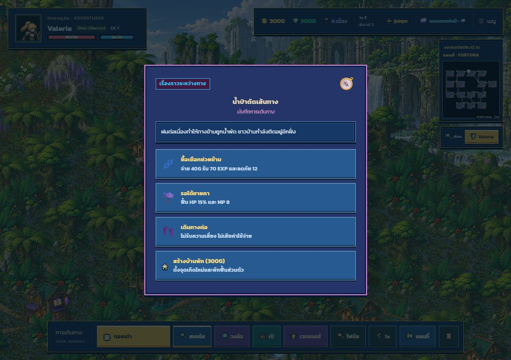

# กติกาการเดินทางรุ่น 2

รื้อระบบการเล่นเมื่อ 18 ตุลาคม 2026 โดยไม่ย้ายข้อมูลจากเซฟรุ่นเดิม แผนที่ งานภาพ
และโมเดลตัวละครเดิมยังใช้ร่วมกับกติกาใหม่ได้

## โครงสร้างหลัก

`GameState.world` เป็นเจ้าของสถานะโลกใน `WorldState.ts` ได้แก่ ตัวสุ่มที่มี seed,
เวลา อากาศรายภูมิภาค พยากรณ์ ภัยสะสม ประวัติอีเวนต์รายคน การสำรวจดันเจี้ยน
บอสที่ถูกปราบและผลการแข่งขัน `EcosystemSystem` กับ `WeatherSystem` เป็นมุมมอง
ของสถานะนี้ ไม่สุ่มหรือเดินเวลาแข่งกันอีก

| ส่วน | หน้าที่ |
| --- | --- |
| `WorldState.ts` | สถานะโลกและลำดับการสุ่มที่บันทึกต่อได้ |
| `Rules.ts` | โอกาสพบศัตรู งบรางวัล เป้าหมาย และธุรกรรมกรรมสิทธิ์เมือง |
| `MatchRules.ts` | เงื่อนไขจบเกมแยกตามโหมด พร้อมผู้ชนะหรือผลสำเร็จของทีม |
| `EventDirector.ts` | กรองเงื่อนไข สุ่มน้ำหนัก กันซ้ำ ตรวจราคา และผลต่อเนื่องของอีเวนต์ |
| `MonsterDatabase.ts` | ข้อมูลที่ทั้งหน้าสำรวจและการเริ่มต่อสู้ใช้ร่วมกัน |
| `CombatRules.ts` | ผลของอากาศ ธาตุ ความลึกดันเจี้ยน และตัวปรับรายสัปดาห์ |
| `JourneyUI.ts` | การเลือกพร ดันเจี้ยน และทางเลือกบริการที่ต้องตัดสินใจ |

## กติกาที่เปลี่ยน

- เวลาเดินหนึ่งครั้งเมื่อครบทั้งรอบ ไม่ขึ้นกับจำนวนผู้เล่น สถานะผิดปกติและระยะเวลา
  คู่หูถูกลดหนึ่งครั้งตอนจบเทิร์นเจ้าของ
- อากาศแยกครบหกอาณาจักร มีพยากรณ์วันถัดไป และส่งผลจริงต่อการเดิน สถิติรบ
  ความเปียก โอกาสเผชิญหน้า และรางวัลจันทร์เลือด ดันเจี้ยนใช้อากาศภายในของตัวเอง
- มีอีเวนต์ 73 นิยาม ครอบคลุม 15 ไบโอม ประกอบด้วยแม่แบบประจำพื้นที่ จุดสำคัญ
  เฉพาะไบโอม อากาศ กลางคืน วิกฤต การช่วยผู้บาดเจ็บ และบริการพื้นฐาน
- ประวัติกันซ้ำแยกผู้เล่น เก็บเหตุการณ์ล่าสุดและระยะพัก เรื่องราวบางอย่างพบครั้งเดียว
  และการช่วยนักเดินทางเปิดเหตุการณ์ตอบแทนหลังผ่านไปอย่างน้อยสองวัน
- จุดสำคัญของแต่ละพื้นที่มีกลไกต่างกัน เช่น กังหันแบ่งรายได้ คบเพลิงสำรอง
  ถ่านเวทกันอากาศ เตาหลอมตีบวก เหยื่อตกปลา รูนจักรกล และการช่วยคู่หูภูตลม
- ทุกตัวเลือกตรวจราคาและเงื่อนไขก่อนเปลี่ยนข้อมูล ปุ่มที่เลือกไม่ได้ถูกปิดใช้งาน
  การกดซ้ำไม่ให้รางวัลซ้ำ AI ประเมินประโยชน์และทรัพยากรของตัวเอง
- ความยากศัตรูเป็นของภูมิภาค ไม่เพิ่มตามอุปกรณ์ เกราะ หรือ HP ของผู้ท้าชิง
  ตัวละครที่พัฒนาจึงกลับไปชนะศัตรูเก่าได้ง่ายขึ้น
- การสำรวจใช้รายชื่อ โอกาสเกิด สถิติอากาศ ธาตุ และสภาพบอสคงเหลือชุดเดียวกับการสู้จริง
  การดูข้อมูลไม่กินลำดับการสุ่ม การประเมินการอยู่รอดใช้ HP ปัจจุบัน
- เวทใช้ MP 10 ท่าอาชีพใช้ MP ตามอาชีพและใช้ได้หนึ่งครั้งต่อไฟต์ Burst ต้องมีเกจเต็ม
  ธาตุที่แพ้เพิ่มความเสียหายเวท 25% และธาตุที่ต้านลดลง 20%
- สนามรบมีจุดพิเศษตามภูมิประเทศทั้งสองฝั่ง การเลื่อนอาชีพยังใช้ท่าตามสายอาชีพเดิม
  พร้อมความสามารถเสริมของอาชีพขั้นสูง
- การเติบโตแยกตามอาชีพ และเปลี่ยน EXP จากการเพิ่มแบบทวีคูณเป็นเส้นทางที่เข้าถึง
  การเลื่อนอาชีพได้ในแคมเปญ
- รายได้เมือง การลงทุน ค่าหัว ดอกเบี้ย และหีบถูกปรับใหม่ เก็บภาษีฉุกเฉินได้หนึ่งครั้ง
  ต่อเมืองต่อวัน ค่าผ่านทางโอนเฉพาะเงินจริงที่ผู้มาเยือนจ่ายได้
- เมืองระดับสามเลือกบทบาทการค้า ป้อม หรือเหมืองได้โดยจ่าย 200G ป้อมเพิ่มกำลังรักษาเมือง
  การปลดปล่อยเมืองที่เคยมีเจ้าของถอดโฉนดเดิมก่อนให้คนใหม่
- มหันตภัยเกิดจากภัยสะสมประจำภูมิภาค มีเส้นตาย ไม่ทับเหตุการณ์ที่กำลังดำเนินอยู่
  และจ่ายค่าหัวแยกแต่ละเมืองจนปลดปล่อยครบ คาราวานทองมีอีเวนต์ที่พบได้จริง
- เควสต์ตรวจภูมิภาค เมือง และผู้มีหมายจับตรงเป้าหมาย มีแรงก์และวันหมดเวลา
  ผลสำเร็จถูกส่งเข้าบันทึกเกม
- ดันเจี้ยนติดตามคบเพลิง หีบที่เปิด ความลึก และผู้พิทักษ์ต่อการสำรวจ
  การกลับออกมาโดยไม่พิชิตไม่มีโบนัส หีบเปิดได้หนึ่งครั้งต่อชั้น โบนัสชั้นรับได้ครั้งเดียว
  การลงลึกเพิ่มกำลังศัตรู 20% ต่อชั้น แสงต่ำกว่า 20% เพิ่มกำลังอีก 20%
- AI มีจุดหมายต่อเนื่อง ใช้ระยะทาง ความเสี่ยงจริง การรักษา เควสต์ ร้านค้าและผู้พิทักษ์
  Darkling ใช้พลังชั่วคราวหนึ่งชั้น ไม่คูณซ้ำ และไม่ลบความก้าวหน้าที่หาได้ระหว่างแปลงร่าง
  มีระยะพักก่อนทำสัญญารอบใหม่
- ร้านค้า กิลด์ และตกปลาเปิดบริการตรง โรงเตี๊ยมให้เลือกพัก/ฟังข่าว เสี่ยงโชค หรือเดินทางต่อ

## เป้าหมายการแข่งขัน

| โหมด | เป้าหมาย |
| --- | --- |
| Standard | แข่งขันทรัพย์สิน 42 วัน หรือสะสมเงิน 12,000G / ครองเมือง 8 แห่ง / พิชิตผู้พิทักษ์หุบเหว |
| Blitz | แข่งขันทรัพย์สินครบ 20 วัน |
| Co-op Raid | ร่วมกันปราบผู้พิทักษ์เป้าหมายของ Solaria, Sunfire และ Frostpeak ภายใน 30 วัน หมดเวลาถือว่าภารกิจไม่สำเร็จ |
| Roguelike Draft | เลือกพรจริงทุกสัปดาห์ ตัวปรับโลกเปลี่ยนรายสัปดาห์ แข่งขันทรัพย์สินครบ 28 วัน |
| Endless Spire | ไม่จบตามจำนวนวัน พิชิตบอสเพื่อเพิ่มชั้นและกำลังผู้พิทักษ์ครั้งถัดไป |

เป้าหมายปัจจุบันแสดงเหนือแผนที่ย่อ เมื่ออยู่ดันเจี้ยนจะแสดงชั้นและคบเพลิงด้วย
Co-op ไม่ให้ผู้เล่นร่วมทีมชนกันแล้วเริ่ม PvP และไม่เปิดสัญญา Darkling

## การตรวจสอบ

`npm run verify` ผ่าน TypeScript, production build, การทดสอบ 225 ข้อ และ CSS coverage
รวมถึงการทดสอบกติกาใหม่ 21 ข้อใน `tests/rules-rebuild.test.mjs` การทดสอบสเกลและโหมดเดิม
ถูกแก้ให้ตรวจพฤติกรรมรุ่นใหม่ แทนการล็อกข้อผิดพลาดของกติกาเดิมไว้

ทดสอบผ่าน UI จริงเพิ่มเติม:

- เริ่ม Co-op ได้ถึงเทิร์นแรกโดยไม่แสดงชัยชนะทันที
- เปิดหน้าดราฟต์ เลือกพร แล้วทอย เดิน และเริ่มต่อสู้จากช่องที่ไปถึงได้
- อีเวนต์น้ำป่าเกิดขณะฝนตกในป่าน้ำตก เลือกช่วยแล้วหัก 40G ได้ผลตอบแทน
  ปิดผลลัพธ์แล้วเปลี่ยนวันและกลับเข้าเทิร์นใหม่
- หลังพิชิตผู้พิทักษ์ เลือกลงชั้นต่อแล้วรับ 350G เติมคบเพลิง และกลับเข้าเทิร์นใหม่ได้

ยังไม่ได้เล่นแคมเปญครบ 42 วันด้วยผู้เล่นจริง หรือทดสอบออนไลน์ข้ามเครื่อง
จังหวะการเล่นและสมดุลระยะยาวควรยืนยันด้วยการเล่นเต็มแมตช์

สำหรับตรวจหน้าจอระหว่างพัฒนา ใช้ `?art-scene=event&biome=waterfall_forest`,
`?art-scene=draft` หรือ `?art-scene=expedition_choice` บน dev server เท่านั้น
