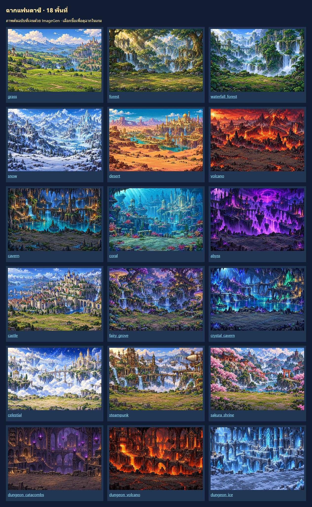
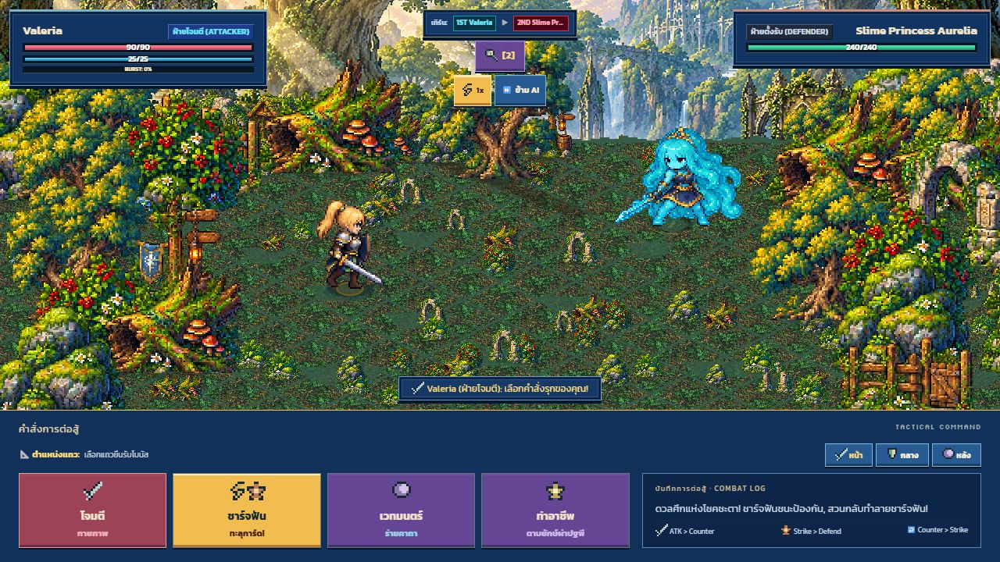
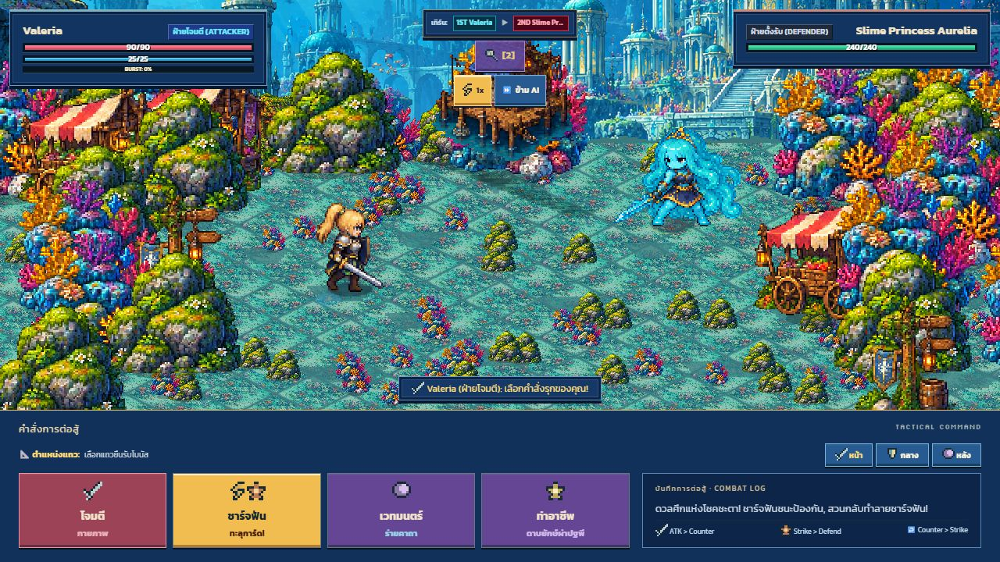
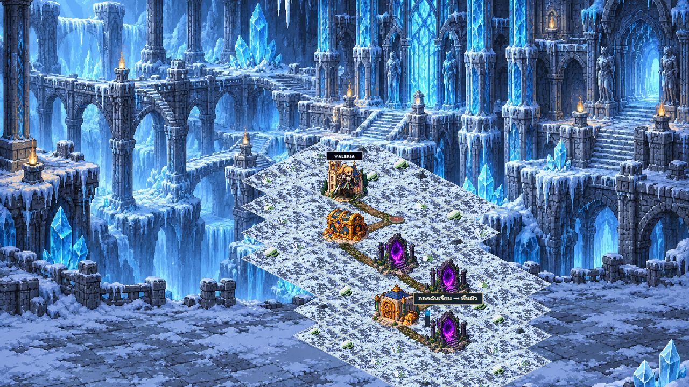

# Generated fantasy backdrops — 2026-10-18

Eighteen original 1536 × 1024 PNG backgrounds were generated using built-in `image_gen` and copied unchanged into [the production asset directory](../../../public/assets/art-v2/backdrops-v1/). [Exact prompts, source paths and destination paths](../backdrops-v1.json) are recorded for every image.

Coverage: grass, forest, waterfall forest, snow, desert, volcano, cavern, coral, abyss, castle, fairy grove, crystal cavern, celestial, steampunk and sakura shrine. Three additional dungeon interiors cover catacombs, volcanic forge and frozen labyrinth. Dungeon node identity (including exit nodes) overrides the outdoor biome.

The world map and battle scenery now use these images instead of the shared procedural sky or dungeon wall. Aspect-preserving nearest-neighbour cover avoids stretched panoramas and blank margins. Battle floors and scenery remain separate playable layers. Outdoor artwork receives a restrained time-of-day tint; these are not separately generated day/night variants. Underground and underwater scenes exclude outdoor birds and the cloud sea. Image loading uses the existing opaque artwork gate and loads backgrounds on demand rather than downloading all eighteen at startup.

Open `/backdrops-review.html` to inspect all original images. Its game-scene links are development fixtures; production builds still show the image gallery. The existing title illustration and foreground terrain/sprite atlases are outside this backdrop update.

Validation: `npm run verify` passes TypeScript, production build, 204 tests and CSS coverage. Tests verify every declared board biome, all dungeon node ranges, unique PNGs, dimensions and viewport aspect ratios. Visually reviewed all eighteen images in the gallery and actual forest/coral battles plus the frozen dungeon. No real multiplayer session or physical mobile device was exercised for this artwork update.

