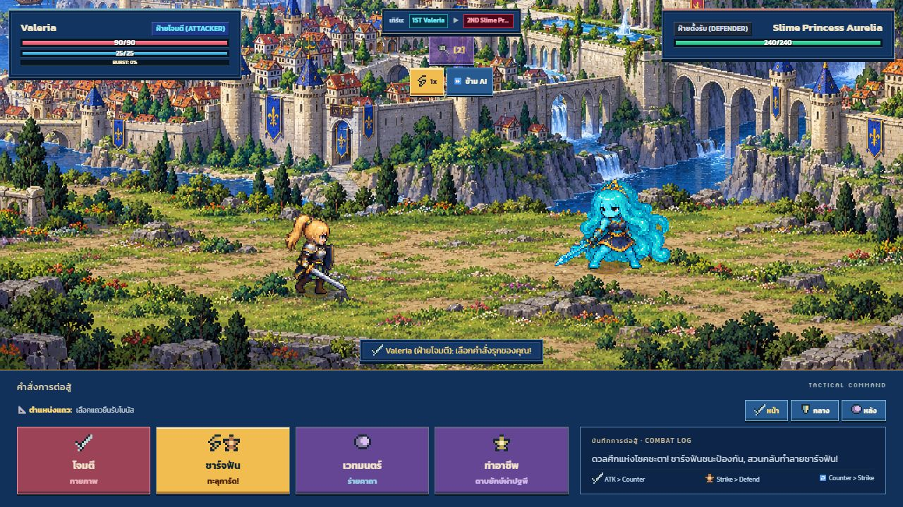
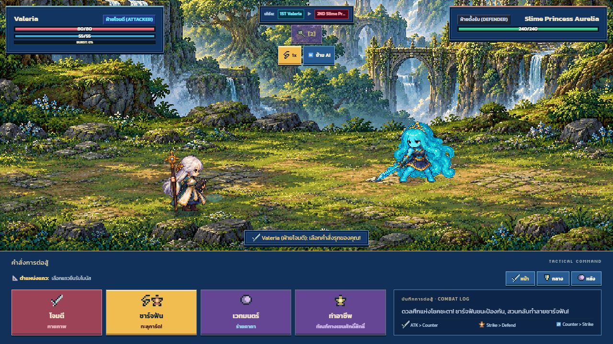

# Battle framing correction — 2026-10-18

The previous arena covered its generated panorama with a tiled board floor and repeated regional map objects. This created a straight horizon seam, miniature architecture, scattered repeated rocks and a mismatch in scale.

Battle scenery now presents the existing generated panorama and its own authored foreground as one continuous scene. Bottom-aligned, aspect-preserving cropping retains the walkable foreground on wide and tall viewports. Shared actor contact points move onto that foreground; all attack, summon and effect positions continue using the same layout. No new raster generation was needed. This supersedes the battle dressing in the world-rebuild-v1 review; overworld and dungeon exploration dressing are unchanged.

The battle scenery cache key also includes node identity so dungeons with the same surface biome cannot reuse the wrong scene.

Validation: npm run verify passes TypeScript, production build, **209 tests** and CSS coverage. New regression checks cover foreground retention at four aspect ratios, grounded contact points, dungeon scene identity and absence of board-floor/miniature-prop overpainting. Browser checks cover castle and forest battles and an actual attack resolving damage, returning combatants and swapping turns. Physical mobile devices were not tested.

