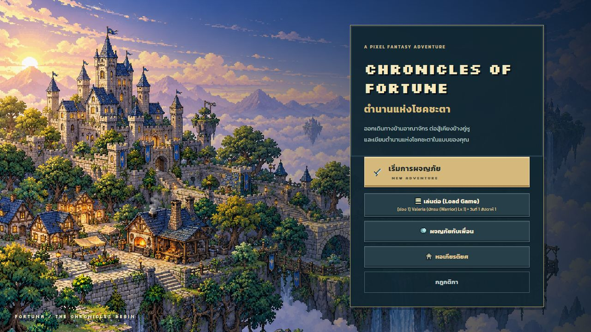
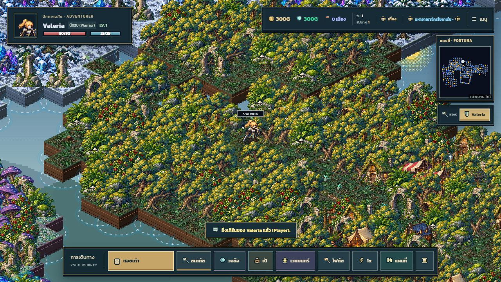
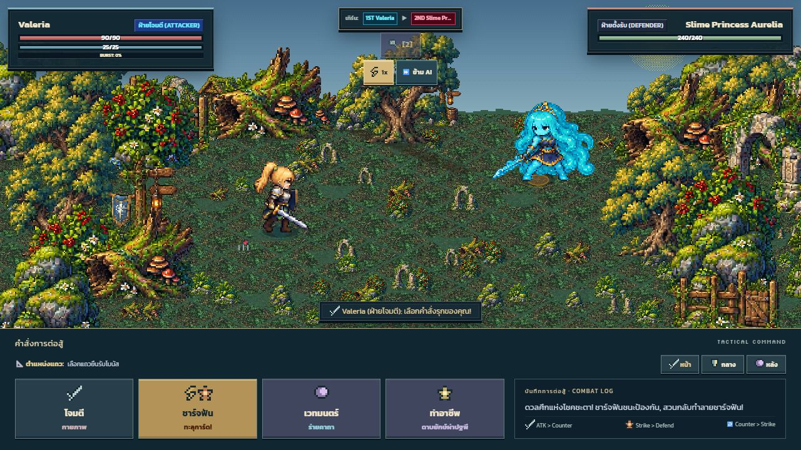
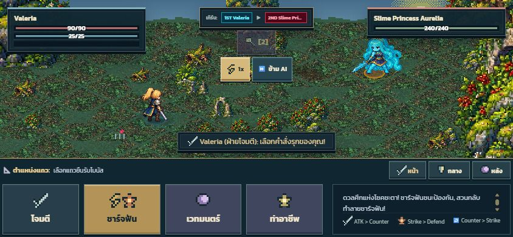
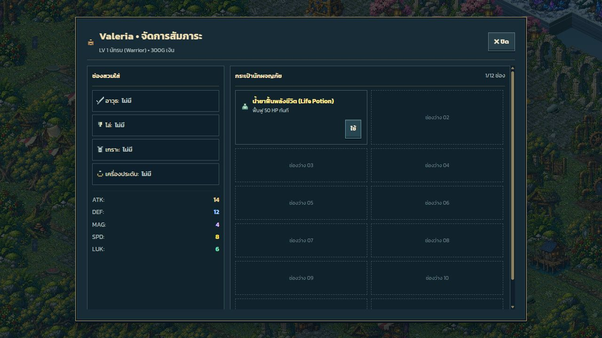
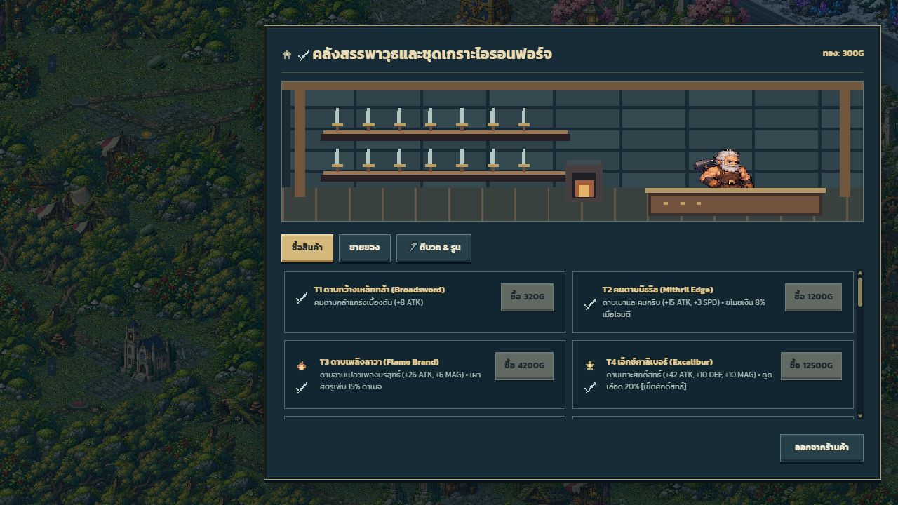
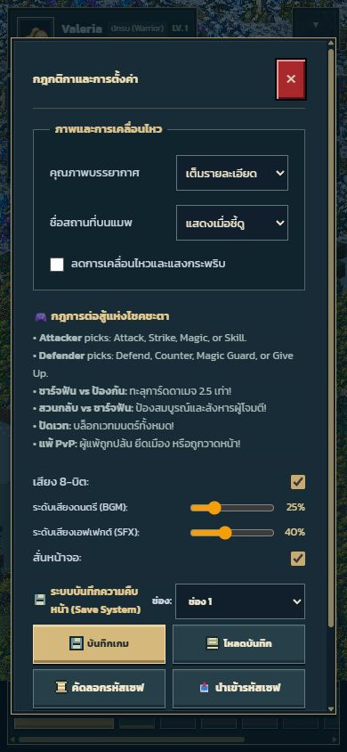

# Fortuna interface overhaul

Reviewed locally on 2026-10-17. The shared interface now uses midnight-blue panels,
engraved brass borders, cream type, sage health accents and violet magic actions.

## Delivered

- Title menu: kingdom artwork, a readable title panel and a distinct new-adventure action.
- Party setup: consistent roster cards, inputs, selected modes and navigation buttons.
- World HUD: larger hero portrait, legible vital bars, economy strip, framed minimap,
  party roster and a journey dock. System actions move into a keyboard-accessible menu.
- Combat: compact combatant cards, turn order, formation controls, command cards and
  a separate narration well. Landscape phones receive smaller cards and shorter commands.
- Inventory: equipment column, statistics and twelve visible satchel positions.
- Shops: two-column catalogue on desktop, one column on phones, larger descriptions,
  distinct tabs and disabled purchase controls when funds/capacity are insufficient.
- Shared modal styling covers towns, map, inspection, settings, reports, rewards,
  events, guild/tavern activities, estate, multiplayer lobby and hall of fame through
  the existing panel/button components, including dynamically mounted dialogs.
- Icon actions have accessible names. Dialogs reference their actual headings.
  Focus rings and the existing reduced-motion preference remain available.

## Verification

- `npm run verify`: typecheck, production build, 190 tests and compiled CSS coverage.
- Browser checks at 1280×720, 390×844 and 844×390.
- Opened title/party setup, world HUD, system menu, settings, inventory, shop and battle.
- Opened inventory from the actual dock; opened settings from the new system menu.
- Space opens the focused system summary without invoking the global dice shortcut;
  Escape closes it and restores focus to the summary.
- Confirmed disabled/available shop purchase states against the fixture's 300G balance.
- No browser console errors in the final world view.
- Temporary viewport override reset after responsive checks.

Optional modes inherit the shared theme; their full gameplay and multiplayer sessions
were not replayed for this interface change. Native fullscreen and physical touch-device
behavior are covered by existing tests plus viewport checks, not a physical-device run.

## Screenshots

## Maintenance

`src/styles/interface.css` loads after the existing art-direction stylesheet and owns
the final component presentation and responsive overrides. `src/ui/Interface.ts` owns
system-menu behavior and accessible labels. Existing IDs are retained so game handlers
continue to address the same controls. Empty inventory positions are decorative DOM
elements and never enter the player's inventory or saved data.
