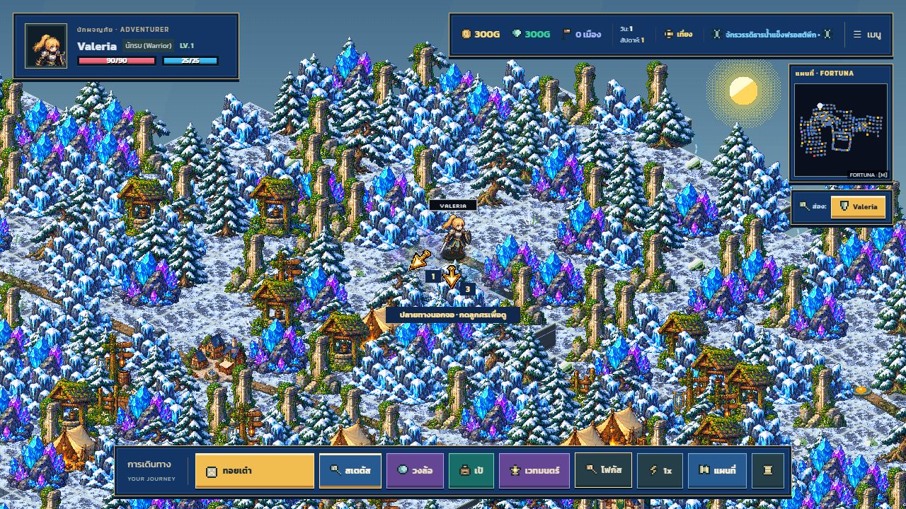
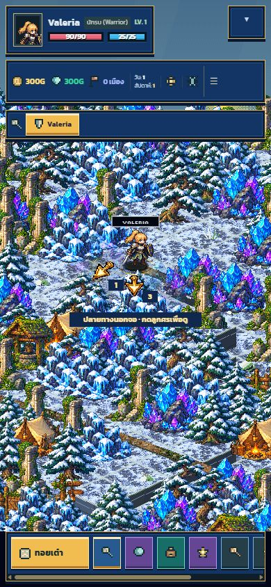
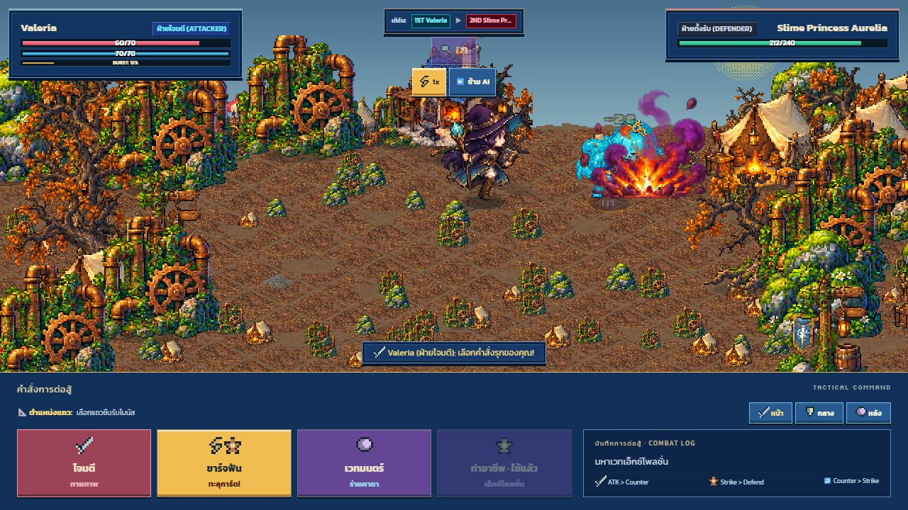
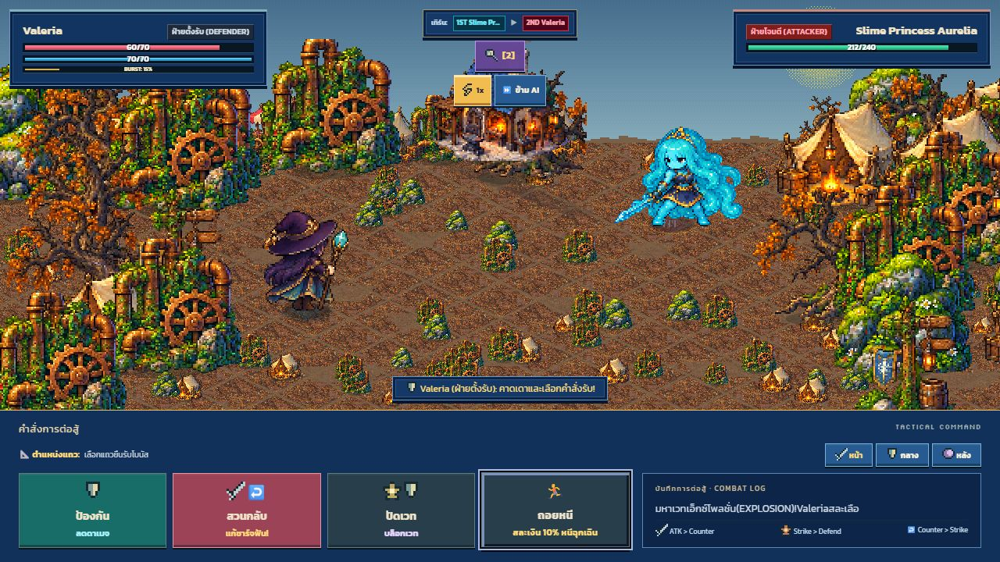

# Continuous combat and destination guidance — 2026-10-18

Combat now runs through a 280 ms dash, 420 ms impact and 340 ms recovery at 1× speed. The impact has continuous follow-through instead of a standing shake. Hitstop no longer freezes effect playback. The delayed blue guard and other secondary status artwork have been removed from the action aftermath; combat calculations and status narration remain intact. Primary skill artwork starts at impact and expires within the recovery choreography.

Destination markers and eight compass directions use [original generated transparent PNG artwork](../../../public/assets/art-v2/navigation-arrows-v1.png), made with built-in image generation. The exact prompt and atlas ordering are recorded in [navigation-v1.json](../navigation-v1.json). Runtime atlas slicing does not repaint the artwork.

After a roll, offscreen destinations are grouped by their actual screen-space bearing around the hero. Count badges show how many destinations lie in each direction, including markers hidden behind the minimap. Clicking a compass arrow focuses the camera on a destination; it does not spend movement. Click the destination marker to choose the actual move. Marker placement and picking share the same building clearance.

## Verification

- `npm run verify`: TypeScript, production build, 200 tests and CSS coverage checks pass.
- Browser: real reachable-path calculation with a 24-step roll, compass click, camera focus and return to hero.
- Browser: 390 × 844 portrait layout and desktop viewport.
- Browser: actual magician skill command, primary impact, recovery and turn swap without the delayed blue shield. Manual playback covers this representative skill, not every job/monster combination or physical device.

