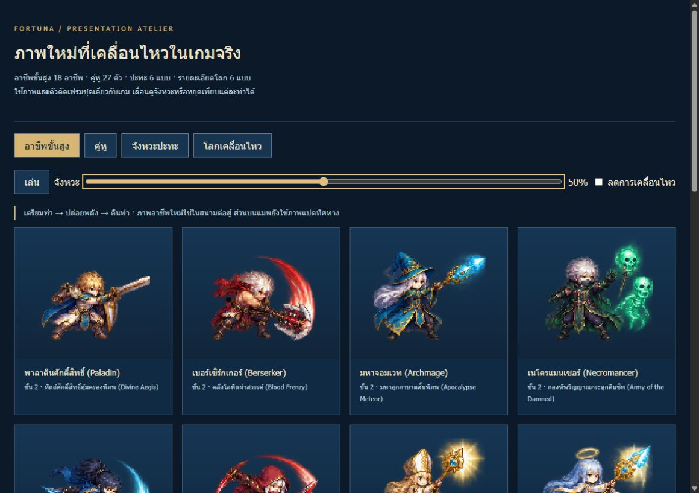
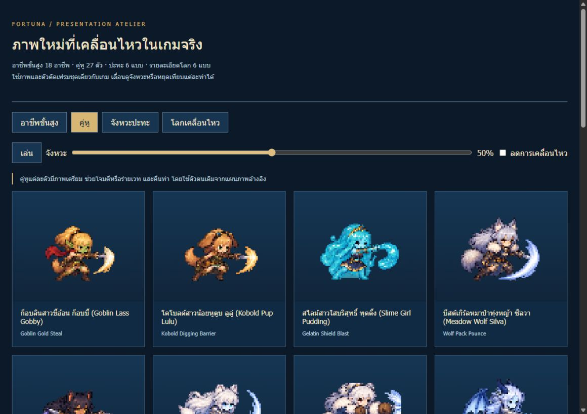
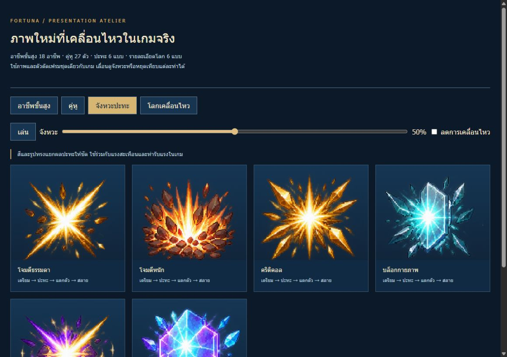
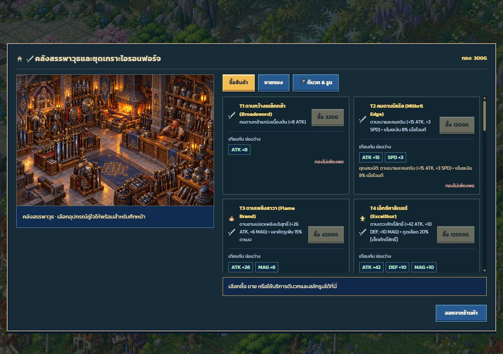
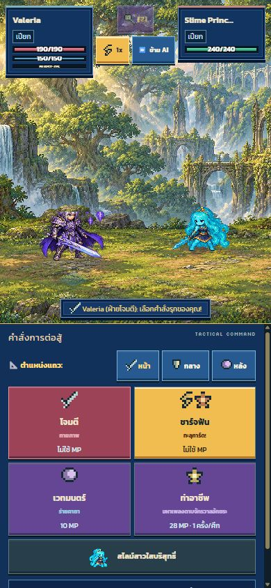

# ภาพ แอนิเมชัน และ UI การต่อสู้ รุ่น 1

อัปเดต 18 ตุลาคม 2026 ครอบคลุมตัวละคร เอฟเฟกต์ปะทะ จังหวะสกิล บอส คู่หู ร้านค้า กระเป๋า และรายละเอียดเคลื่อนไหวบนแมพ

## ภาพที่สร้างและเชื่อมเข้าเกม

สร้างด้วยเครื่องมือ OpenAI image generation ในตัว แยกเก็บใน `public/assets/presentation-v1/` รวม **7 แผ่น / 225 ช่องภาพ** ไม่เขียนทับชุดภาพเดิม

| แผ่นภาพ | ช่องภาพ | การใช้งานจริง |
| --- | ---: | --- |
| `promotion-2.png` | 36 | อาชีพขั้นสอง 9 อาชีพ × เตรียมพร้อม เตรียมโจมตี ปล่อยท่า และคืนท่า |
| `promotion-3.png` | 36 | อาชีพขั้นสาม 9 อาชีพ × 4 ท่า |
| `companions-1.png` ถึง `companions-3.png` | 81 | คู่หูทั้ง 27 ตัว × เตรียม ช่วยรบ และคืนท่า |
| `impact.png` | 36 | ตีธรรมดา ตีหนัก คริติคอล บล็อก สวนกลับ และเกราะเวท × 6 เฟรม |
| `world.png` | 36 | ธง เตาหลอม กังหันน้ำ ช่องไอน้ำ แม่ค้า และนก × 6 เฟรม |

พรอมป์ต์ต้นฉบับอยู่ใน [prompts.json](../../../../public/assets/presentation-v1/prompts.json) และคำสั่งเก็บรายละเอียดขอบภาพอยู่ใน [refinements.json](../../../../public/assets/presentation-v1/refinements.json) ส่วน `manifest.json` บันทึกขนาดจริง จำนวนช่อง และ SHA-256 ของไฟล์ที่ส่งมอบ

แผ่นภาพที่เครื่องมือส่งกลับมีขนาดและช่องว่างไม่สม่ำเสมอ ตัวอ่านจึงค้นหาขอบโปร่งใสก่อนตัดเฟรม ใช้สเกลร่วมกันในแต่ละแผ่น และจัดจุดวางเท้าซ้ำที่เดิม ภาพคู่หูตัดเศษจากช่องข้างเคียงออกหลังย่อด้วย nearest-neighbor แคชเฟรมจำกัด 240 รายการ และโหลดเฉพาะแผ่นที่กำลังใช้

ภาพอาชีพใหม่ใช้ในสนามต่อสู้ บนแมพยังใช้ชุดภาพแปดทิศทางเดิม สกินพิเศษ การแปลงร่าง Darkling และหน้าตาที่ถูกแกล้งยังผ่านตัวเรนเดอร์เดิมเพื่อรักษารูปลักษณ์ที่เลือกไว้

## จังหวะและ UI

- แยกช่วงเตรียมท่า พุ่งหรือร่าย ปะทะ และคืนท่า ความเร็วต่างกันตามอาชีพและตระกูลมอนสเตอร์ สายเวทร่ายจากระยะไกล สายเร็วเตรียมท่าสั้นกว่า และท่าหนักมีน้ำหนักมากขึ้น
- ใช้ภาพปะทะองค์ประกอบเดียวในแต่ละจุด เริ่มที่เฟรมสัมผัสให้ตรงกับตัวเลขดาเมจ สกิลเฉพาะเจ้าของยังใช้แผ่นภาพเดิมพร้อมจังหวะใหม่
- บอสมีป้ายเปิดตัวหลังโหลดภาพพร้อม ป้ายไม่ขวางการควบคุม คู่หูเล่นท่าช่วยรบและก้าวเข้ามาก่อนคืนท่า
- ปุ่มต่อสู้แสดง MP และเหตุผลที่ใช้ไม่ได้โดยตรง พร้อมป้ายสถานะและสี HP ต่ำ มือถือแนวตั้งจัดปุ่มหลักสองคอลัมน์
- ร้านค้าและกระเป๋าแสดงโบนัสอุปกรณ์เพิ่ม–ลดเทียบช่องเดียวกัน รวมคุณสมบัติพิเศษ กระเป๋ามีตัวกรองทั้งหมด/อุปกรณ์/ของใช้ และอัปเดตหลังสวมใส่
- ของตกแต่งโลกอยู่ข้างอาคาร ใช้การเรียงความลึกและลดการบังตัวละคร จำกัด 14 จุดในโหมดเต็ม และ 6 จุดในโหมดสมดุล โหมดลดการเคลื่อนไหวหยุดภาพโลกและการพุ่งตัว

## เปิดดู

รัน `npm run dev` แล้วเปิด `/presentation-review.html` เพื่อเลือกประเภทภาพ หยุด เล่น หรือเลื่อนเฟรม ใช้ตัวอ่านภาพชุดเดียวกับเกมและมีลิงก์ไป `/effects-review.html` สำหรับดูสกิลเฉพาะเจ้าของทั้งหมด

ฉากตรวจใน dev server:

- `/?art-scene=battle&job=paladin&companion=true`
- `/?art-scene=battle&job=rune_sovereign&companion=true`
- `/?art-scene=boss&job=crusader`
- `/?art-scene=inventory`
- `/?art-scene=shop_weapon`
- `/?art-scene=world&biome=forest&metrics=true`

## การตรวจสอบ

`npm run verify` ผ่านครบทั้ง TypeScript, production build, **243 tests** และ CSS coverage ชุดทดสอบใหม่ตรวจภาพทุกช่อง พื้นโปร่งใส SHA-256 การจับคู่ 18 อาชีพ ขอบตัดที่ไม่เท่ากัน จังหวะแอนิเมชัน โหมดลดการเคลื่อนไหว ค่า MP สถานะ และการเปรียบเทียบอุปกรณ์

ทดสอบผ่านเบราว์เซอร์เดสก์ท็อปและ viewport มือถือ 390 × 844 / แนวนอน 844 × 390: ใช้ท่าอาชีพจริง (หัก MP และสลับฝ่าย), เรียกคู่หู, เปิดตัวบอส, กรองกระเป๋า, ซื้อโล่ในร้าน (300G → 40G และของเข้าแท็บขาย), และแกลเลอรีภาพครบ 18 อาชีพ / 27 คู่หู ยังไม่ได้วัด FPS หรือหน่วยความจำบนโทรศัพท์จริง

