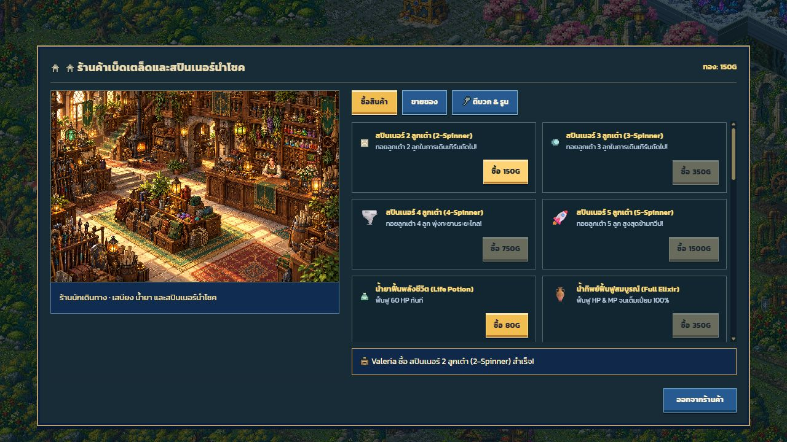
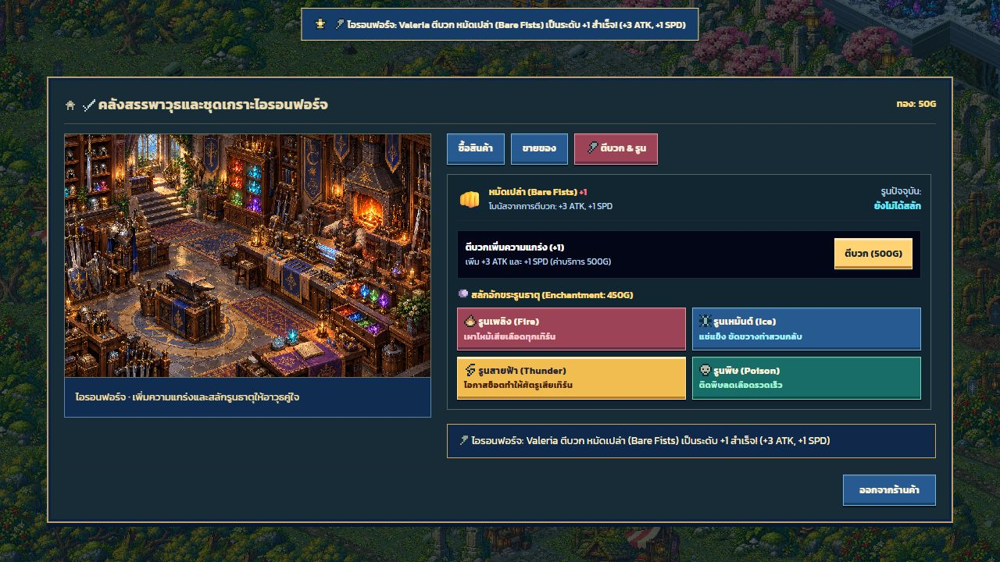
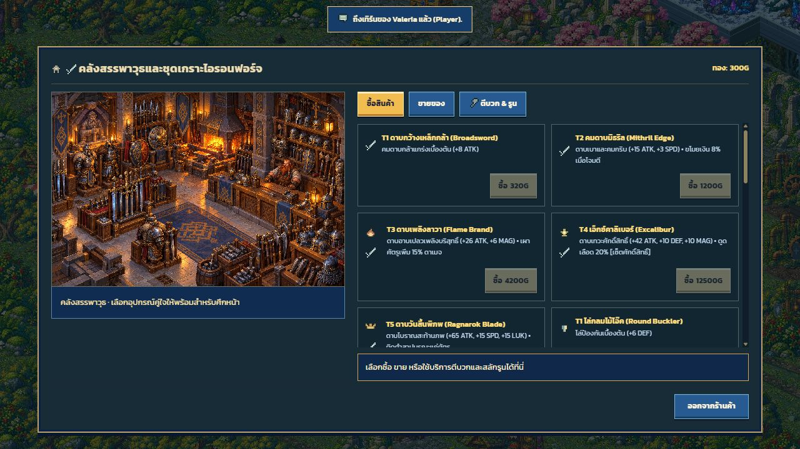
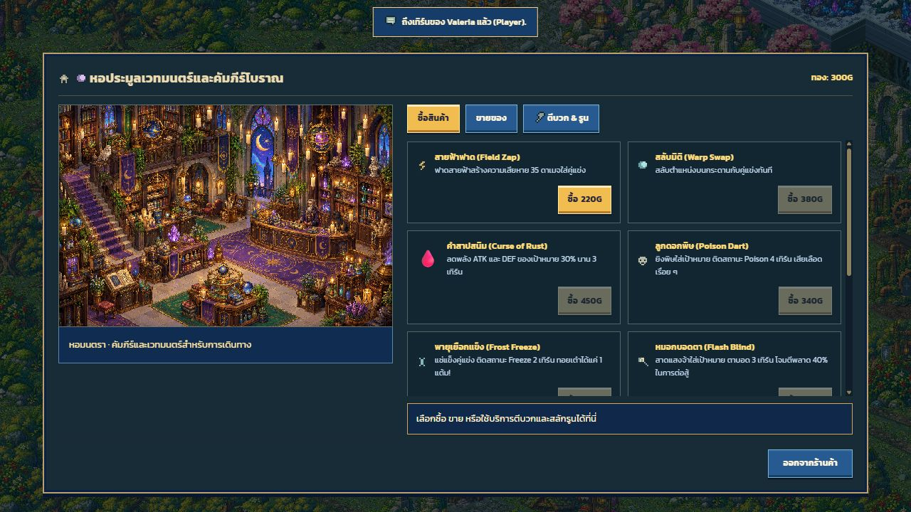
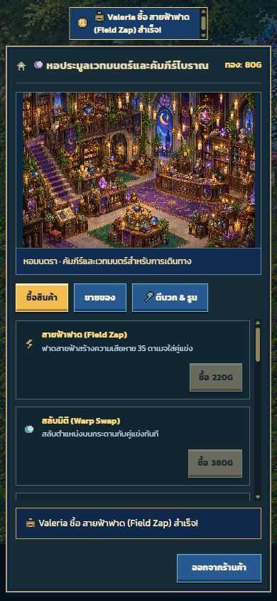

# Generated shop interiors and layout — 2026-10-18

Four original pixel-art interiors were generated with built-in `image_gen`, then copied unchanged into [the production directory](../../../public/assets/art-v2/shop-interiors-v1/):

- [General store](../../../public/assets/art-v2/shop-interiors-v1/shop_item.png)
- [Armory](../../../public/assets/art-v2/shop-interiors-v1/shop_weapon.png)
- [Magic shop](../../../public/assets/art-v2/shop-interiors-v1/shop_magic.png)
- [Forge and rune workshop](../../../public/assets/art-v2/shop-interiors-v1/shop_forge.png)

The [exact prompt set and original source paths](../shop-interiors-v1.json) record each asset. Images render at their original 3:2 aspect ratio with nearest-neighbour scaling. Shop and service tabs select the matching interior, with the existing artwork loading gate preventing the previous procedural shop from flashing underneath. The obsolete procedural shop painter has been removed.

The centered shop dialog uses two desktop columns: complete artwork and location description on the left; tabs, scrollable products/services and persistent feedback on the right. Forge sections stretch across the service column rather than shrinking to their text width. Mobile stacks the same content with a single product column on narrow phones and reachable exit controls.

Shop results appear in a persistent `aria-live` status region and the floating toast sits above the dimming layer. Toast text wraps instead of truncating. The old side event-feed window is hidden only while the shop is open so it cannot cover the centered catalog; the log itself is retained. Town panel feed behavior remains unchanged.

Validation: `npm run verify` passes TypeScript, production build, 204 tests and CSS checks. Browser checks covered all four images, purchase (300G → 150G), resale (150G → 240G), forge refusal at 240G, successful upgrade (300G → 50G, +1), and a magic purchase on a 390 × 844 portrait viewport (300G → 80G). No physical mobile device or real multiplayer session was tested.

