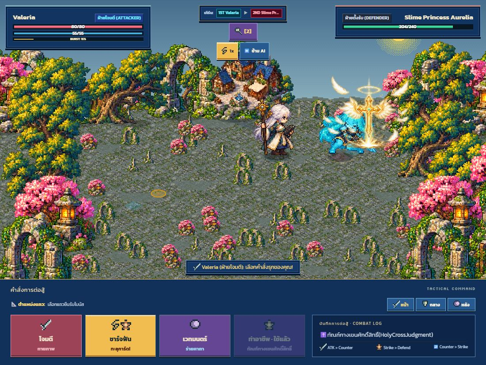
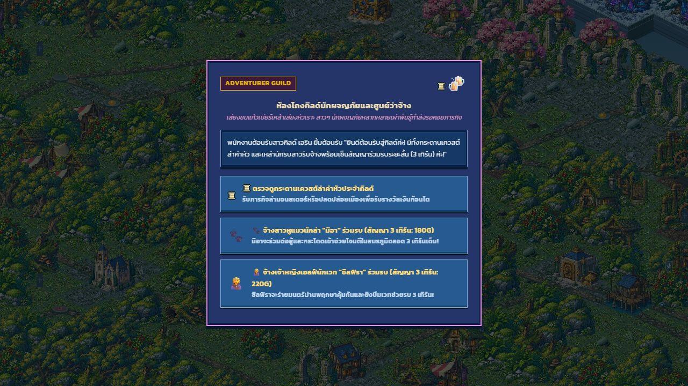
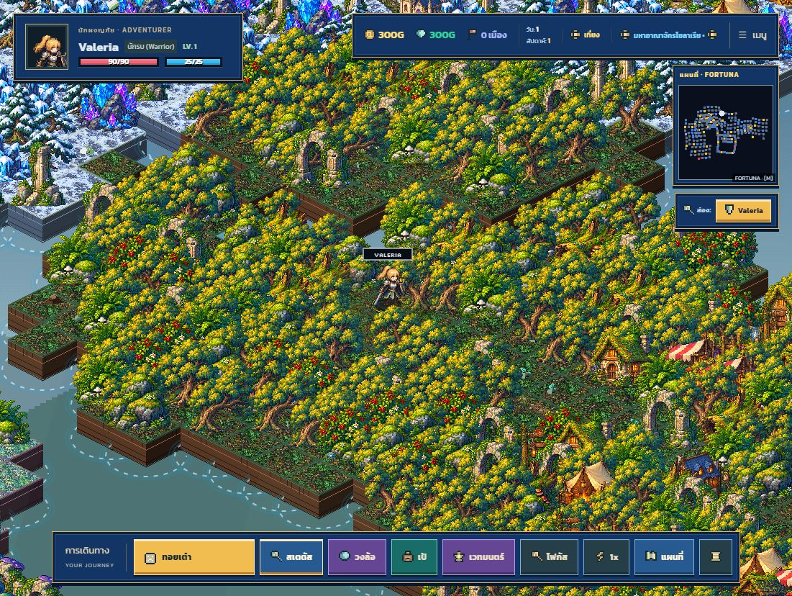
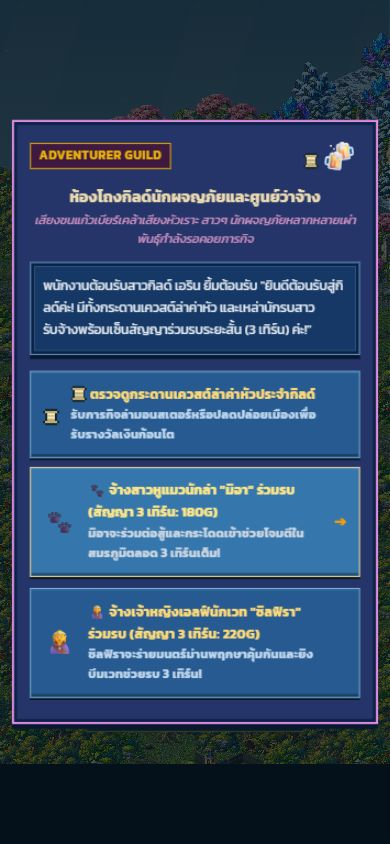

# Combat, loading and colour fixes — 2026-10-17

The staged aftermath described below is superseded by the [continuous combat flow update](../navigation-flow/README.md), which removes delayed secondary status artwork.

## Problems reproduced

- The combat path emitted a signature, generic summon, beam and several reactions
  into the same hit zone. Skill text was also drawn by two independent systems.
- The skill vignette painted visible rectangular bands around the arena. Motion
  ghosts used a different foot offset from the live actor and looked like duplicate sprites.
- Generated PNG cells contained very faint matte pixels at their exterior edges.
- `pixel-box-pink` supplied accent variables without an opaque panel surface. The
  fantasy guild event therefore showed the map through its entire dialog.
- Production atlases loaded lazily while procedural terrain and legacy actor
  fallbacks were already visible. Cache invalidations subsequently changed their appearance.
- More-specific legacy CSS rules kept some action buttons in the previous muted colours.

## Changes

- One signature composition per hit zone; nearby extra compositions are suppressed.
  Separate targets can still show independent effects. Impact, aftermath and healing
  are staged in sequence, and effect playback follows the selected game/battle speed.
- One action title during the introduction, removed before impact. Removed banded
  vignette dimming and duplicate motion silhouettes. Signature scale is capped at
  two native pixel multiples, and the attacker stands farther from the target during skills.
- Clean only the extracted frame's alpha matte and three-pixel exterior gutter.
  Disconnected bright particles and original RGB remain intact. Source PNGs are unchanged.
- Opaque surfaces for every panel frame variant, including pink and Darkling frames.
  Mobile display selection sits above event dialogs to prevent a click reaching a choice below.
- Track production atlas loading behind a solid progress screen. Decode/cut/cache
  updates and two animation frames finish before revealing the scene. Failed or
  timed-out requests show a retry action. Hero, monster and companion rendering no
  longer switches to legacy image designs while its production atlas is pending.
- Preload action poses together with motion poses. Clear cached battle scenery before
  the loading gate opens, so the first visible backdrop contains the finished materials.
- Brighter blue, gold, teal, rose and violet interface colours. Cached ground, foliage,
  buildings and detail pixels receive a modest chroma/luminance increase; alpha and
  pixel dimensions are preserved. Night shading still follows the scene's time of day.

## Verification

- `npm run verify`: TypeScript, production build, **196 tests**, compiled CSS coverage.
- All **792** source frames remain nonempty after extraction and have fully clear exterior gutters.
- Tests cover owner-art priority, delayed aftermath, 1920×1080 scale limits, pixel alpha
  cleanup, absence of skill vignette geometry, palette alpha preservation, concurrent
  image completion, repaint ordering and failed-load retry state.
- Browser: pressed the real cleric skill command and captured its impact; opened the
  actual fantasy guild event; confirmed its surface is `rgb(37, 53, 106)` at opacity 1.
- Browser: world/HUD colours, atlas loading screen and no console errors in the world view.
- Browser: guild choices at 390×844, including the display-mode prompt above the event;
  no accidental choice after selecting portrait mode. Temporary viewport reset afterwards.
- New animations, other jobs and monsters share the tested player. Every possible
  combat rule combination and physical mobile device was not replayed manually.

