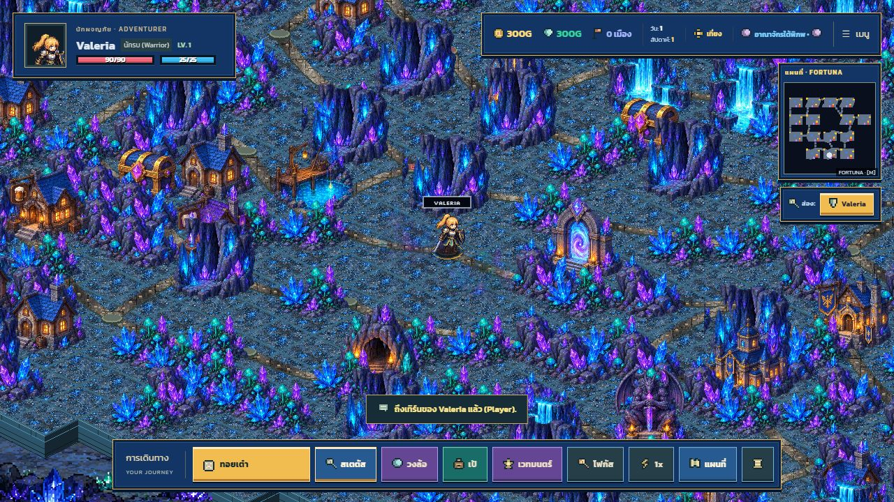
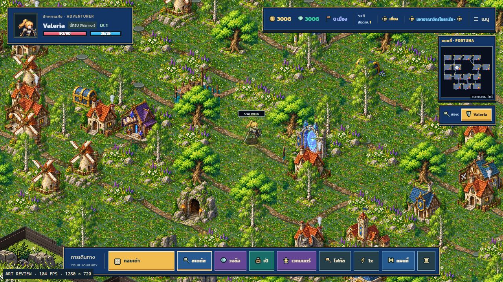
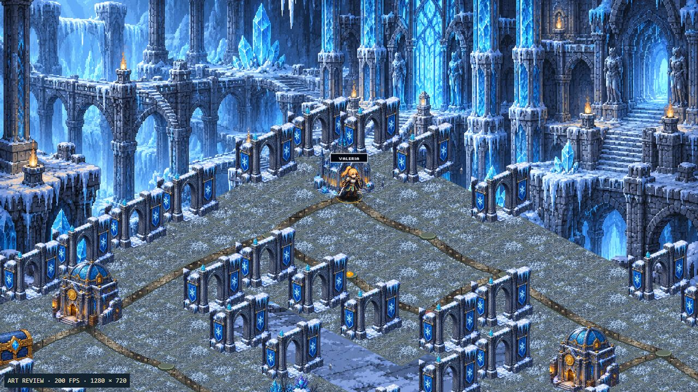
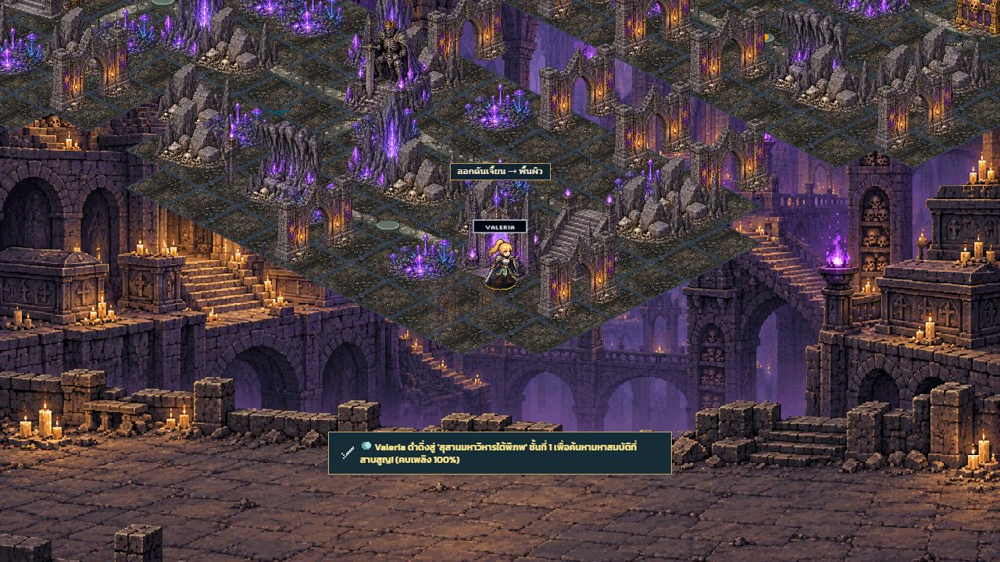
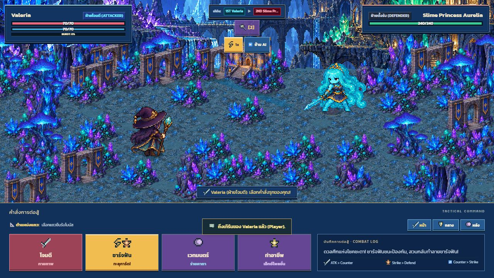
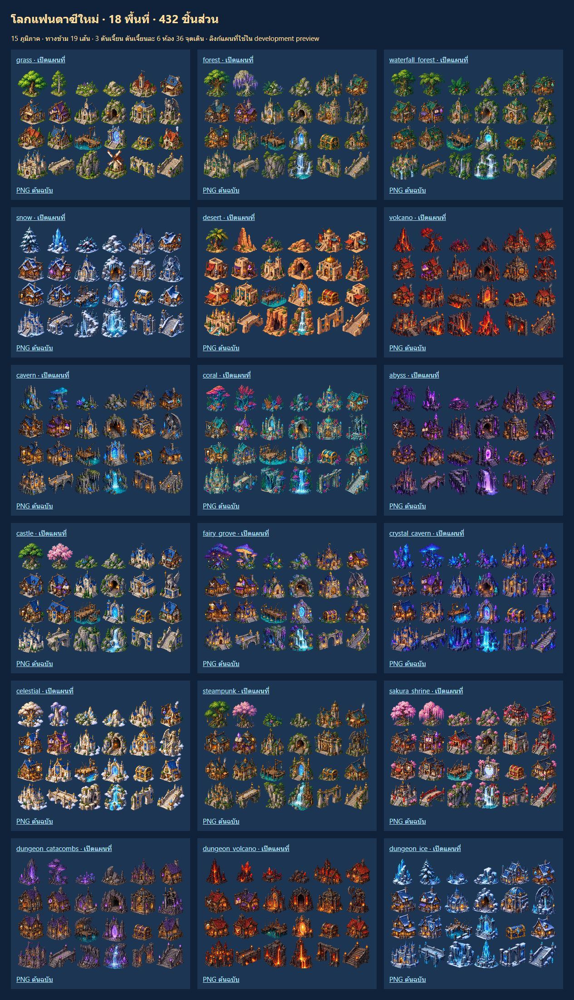

# Fantasy world rebuild — 2026-10-18

This replaces the production surface map and all three dungeon layouts. Start a new game to use the baseline. The user explicitly waived old-save compatibility; no migration was added.

## Layout

- **760 connected surface destinations**, 15 named regions, six realms and 45 towns.
- **19 regional connections** with actual playable bridge, skyway, tunnel-approach and causeway steps. Forest roads bend, desert roads arc and rock-region roads follow irregular lines; cities retain straighter streets.
- Every region has its own item/weapon/magic shops, shrines, guild, inn, homes, fishing site, treasure and guardian.
- **Three 36-node dungeons**, each with six rooms, circular room routes, connecting doors, optional treasure, guardian hall and surface exit. All 36 nodes belong to their dungeon's camera/cache group.
- Torch use is 4% per step to support the expanded routes; darkness begins at 20% and the torch expires after 25 steps.

[layout.json](layout.json) records region positions and connections. [rebuild-fantasy-world.cjs](../../../scripts/rebuild-fantasy-world.cjs) regenerates the checked-in arrays deterministically.

## Artwork

Built-in `image_gen` produced **18 transparent sheets × 24 objects = 432 sprites**, plus **20 ground materials**. Original PNGs are copied unchanged into [the production directory](../../../public/assets/art-v2/world-rebuild-v1/). [prompts.json](prompts.json) records exact prompts, source paths, destinations and cell order.

Each region has separate nature formations, undergrowth, rocks, town, three shops, sanctuary, physical dungeon entrance, bank vault, guardian statue, inn, guild, fishing platform, travel gate, chest, home, capital, bridge, cliff, landmark, wall and stairs. Their materials and architecture match their generated panoramas. A bank is not a scaled chest, and a wall is not a stretched tree.

Sprites use a consistent 128px extraction canvas, preserve generated transparency and anchor their visible foot to the ground. Dungeon dressing uses walls, crags and pillars instead of outdoor foliage. Twenty new materials include three distinct dungeon floors and separate earth/stone paths. Projection and cliff geometry remain procedural; the production renderer disables the previous procedural surface decorations and tile contours.

The surface has **12,007 ground cells and roughly 3,600 scenic placements**. Walking corridors and actor/building contacts stay clear; low plants fill verges, homes gather near hubs, and larger nature pieces occupy wilderness and edges. Scenery shares actor depth sorting and fades if it would obscure a character. World maps, dungeons and battles use the same regional art identities. Sheets load by visible region through the artwork gate.

Open `/world-rebuild-review.html` to inspect all eighteen sheets. Map links are development fixtures. Existing generated panoramas and shop interiors remain in use.

## Verification

`npm run verify` passes TypeScript, production build, **208 tests** and CSS coverage; see [verify-log.txt](verify-log.txt). Tests cover connected routes, unique positions, valid towns/homes, all dungeon rooms/exits, scene isolation, generated scenery, floor projection, 432 occupied transparent cells, unique sheets, service art roles and torch lifetime. Existing combat, movement, network-state and navigation privacy tests also pass.

Browser checks: complete art gallery, grass/crystal maps, frozen dungeon, catacomb exit, crystal battle, and actual two-step selection → running → arrival event. Live multiplayer, physical phones and full campaign balance were not manually tested.

