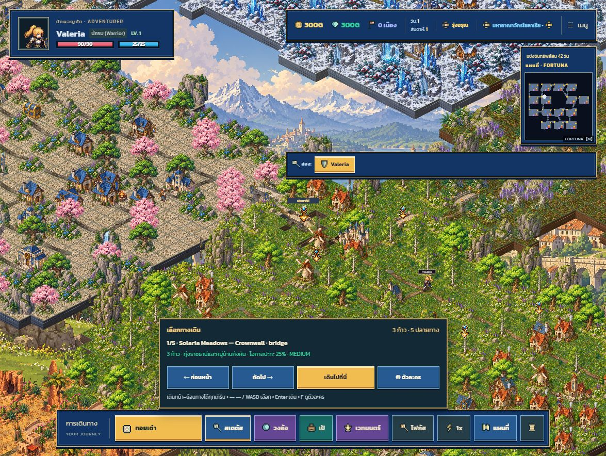
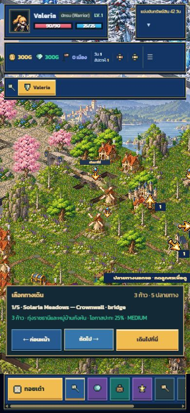

# Bidirectional board movement and destination controls

Each turn starts with either road direction available, including the road used in the
previous turn. Exact dice totals and flexible crystals keep their existing rules.
During travel, reversing immediately is allowed only at a dead end.

The destination dock supports touch buttons, arrow keys/WASD and controller D-pad.
It shows the actual route length, location, encounter chance and rival presence before
confirmation. The camera follows the preview; F or the hero button returns to the actor.
Native keyboard activation on focused buttons remains available.

Highlighting and pathfinding share one graph traversal. Travel validates every edge,
the dice total, start/end and U-turn rules. Repeat travel during animation is ignored.
Received multiplayer movement paths use the same validation without running spectator
tile effects. Navigation hides during dialogs, dice animation, AI and remote turns.

## Verification

- `npm run verify`: TypeScript, production build, all 248 tests and CSS coverage pass.
- New regression tests cover backwards starts, forward starts, exact/flexible stops,
  dead-end reversals, invalid paths, duplicate execution and real-world route consistency.
- Browser: destination buttons change the preview and focus the camera; ArrowRight
  works after clicking the dock; confirming travels to the destination and opens its
  normal tile event. No browser console errors observed.
- Responsive check: 390 × 844 portrait and desktop; touch buttons remain reachable.
- Browser verification used the existing development fixture
  `/?art-scene=world&node=2&roll=3`; it does not change production startup.
- Internet multiplayer was not manually exercised; existing multiplayer regression
  tests pass with the shared movement rules.

